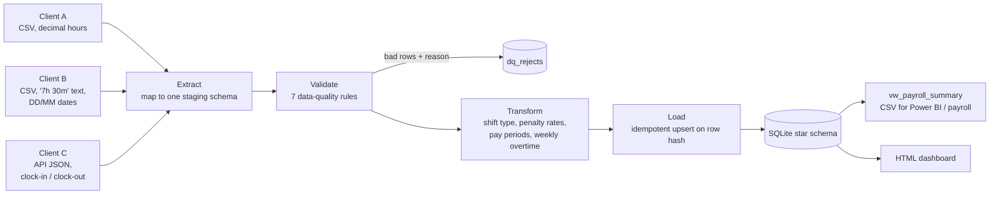

# Payroll ETL Pipeline

An end-to-end data engineering project: three clients send timesheets in three different formats, and this pipeline turns them into a validated, query-ready payroll warehouse with a reporting layer for Power BI.

**Live dashboard:** [kalpana-zala.github.io/payroll-etl-pipeline](https://kalpana-zala.github.io/payroll-etl-pipeline/)
  

---

## The problem

Payroll teams often receive hours from clients in whatever format each client's system produces. Someone copies them into a spreadsheet by hand, applies penalty rates and overtime by eye, and hopes nothing was missed. That is slow and error-prone, and bad rows are discovered only after a payslip is wrong.

## What the pipeline does



| Stage | What happens |
|---|---|
| **Extract** | One extractor per source format maps every client into the same staging columns. Nothing is fixed or dropped here. |
| **Validate** | Seven rules: missing employee ID, unparseable date, unparseable hours, zero/negative hours, shifts over 16 h, unknown employee, duplicate row. Failing rows go to `dq_rejects` with the source file and row number so the client can correct them. |
| **Transform** | Classifies each shift (Weekday, Evening, Saturday, Sunday, Public holiday), applies the penalty multiplier, assigns ISO week and fortnightly pay period, and calculates weekly overtime above 38 hours. |
| **Load** | Writes dimensions and facts to a star schema. Each fact row has a business-key hash, so re-running on the same files inserts nothing (idempotent) and new files add only new rows (incremental). Every run is recorded in `etl_run_log`. |

## Data model

- `dim_client`, `dim_employee`, `dim_pay_period`
- `fact_timesheet`: one row per validated shift with hours, overtime and pay
- `dq_rejects`: quarantined rows with reason codes
- `etl_run_log`: rows extracted / valid / rejected / inserted / skipped per run
- `vw_payroll_summary`: employee × pay period view that payroll and Power BI consume

The SQL is standard and ports to SQL Server or BigQuery with minor type changes.

## Results on the sample data

| Metric | Value |
|---|---|
| Rows extracted from 3 sources | 1,507 |
| Rows rejected by data-quality rules | 7 (every planted issue caught) |
| Pass rate | 99.54% |
| Shifts loaded | 1,500 |
| Re-run on the same files | 0 inserted, 1,500 skipped |

## Run it

Works locally or in Google Colab (free, nothing to install beyond pandas).

```bash
pip install -r requirements.txt
python scripts/generate_sample_data.py     # create the dummy source files
python run_pipeline.py --full              # build the warehouse from scratch
python run_pipeline.py                     # incremental re-run (inserts nothing new)
python dashboard/build_dashboard.py        # build output/payroll_dashboard.html
python -m pytest -q                        # 5 unit tests
```

Outputs land in `output/`: `payroll_warehouse.db`, `payroll_summary.csv`, `dq_report.json` and `payroll_dashboard.html`.

Example analysis queries (period-over-period change with `LAG`, weekly hours above threshold, penalty-rate exposure, data-quality trend) are in `sql/analysis_queries.sql`.

## Project structure

```
payroll-etl-pipeline/
├── data/
│   ├── raw/                 # three client exports (CSV, CSV, JSON)
│   └── reference/           # employee master, pay rules, public holidays
├── etl/
│   ├── config.py            # paths, business rules, thresholds
│   ├── extract.py           # one extractor per source format
│   ├── validate.py          # data-quality rules + row hashing
│   ├── transform.py         # shift classification, pay, overtime
│   └── load.py              # schema, upserts, run log
├── sql/
│   ├── schema.sql           # star schema + reporting view
│   └── analysis_queries.sql
├── dashboard/               # HTML template + builder
├── scripts/generate_sample_data.py
├── tests/test_pipeline.py
└── run_pipeline.py
```

## Next steps

- Schedule daily runs (cron, Airflow or Azure Data Factory)
- Swap SQLite for SQL Server or BigQuery and connect Power BI with scheduled refresh
- Pull Client C directly from its API instead of a saved JSON file
- Email the `dq_rejects` list to each client automatically

---

Built by **Kalpana Zala**. All names and figures are fictional.
